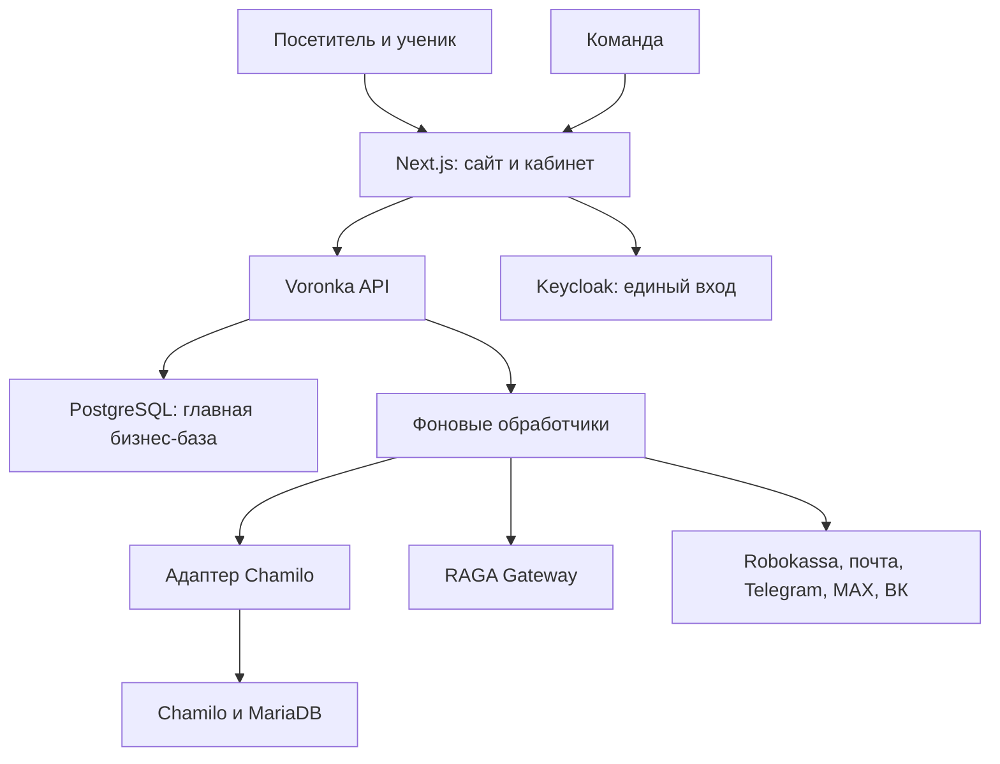

# Архитектура единой платформы: Next.js + Voronka CRM + Chamilo + RAGA

Дата: 2026-11-09. Статус: архитектурное описание для реализации, а не отчёт о готовом продукте.

Этот документ дополняет [объём CRM](CRM_IMPLEMENTATION_SCOPE.md) и [единую модель данных](PLATFORM_DATA_MODEL.md). Новое решение владельца: продающий сайт и личный кабинет на Next.js, обучение на собственной Chamilo. При противоречиях о формате выдачи курсов действует этот документ. Работающие функции описаны в READINESS.md.

## 1. Цель

Одна платформа сопровождает человека от старой базы/рекламы до покупки, обучения, онлайн-занятий, архивов и сертификата. Владелец управляет клиентами, продуктами, деньгами, персональными правами и коммуникациями в веб-CRM.

Команда: владелец, партнёр, до 10 аккаунт-менеджеров. Количество учеников — отдельная характеристика нагрузки и не ограничено количеством сотрудников. Telegram, MAX и ВК сохраняются.

Человек видит один логин, свои программы, материалы, документы, расписание, финансовую информацию и условия доступа. Отдельный небольшой семинар может выдаваться в Telegram и/или кабинете без обязательного создания полноценного курса в LMS.

## 2. Решения

| Область | Решение |
|---|---|
| Продающий сайт | Next.js: каталог, лендинги, предложения, корзина/заказ, оформление |
| Личный кабинет | Next.js: мои курсы, архив, материалы, онлайн-занятия, документы, финансы |
| Кабинет команды | Next.js: CRM, CSV, сделки, диалоги, кампании, управление правами |
| Бизнес-сервер | Развитие FastAPI Voronka модульным монолитом |
| Учебная система | Chamilo отдельным приложением на выделенном поддомене |
| Главная бизнес-БД | PostgreSQL: клиенты, сделки, каталог, заказы, деньги, права, коммуникации |
| Учебная БД | Собственная MariaDB/MySQL Chamilo; штатная схема не смешивается с CRM |
| Единый вход | Keycloak как выделенный поставщик идентификации, login/password, интеграция с Next.js и Chamilo |
| Интеллектуальный сервис | Отдельный RAG_for_AI/RAGA Gateway |
| Фоновые действия | Существующие Inbox/Outbox плюс отдельные задания LMS/ИИ/почты/кампаний |
| Оплата | Robokassa на первом этапе; ЮKassa на втором |
| Файлы | Закрытое файловое/S3-совместимое хранилище, единые метаданные и проверка доступа |
| Онлайн-занятия | Адаптер видеоконференций; первая реализация может выдавать разрешённую ссылку на существующую комнату |
| Twenty | Необязательна; выборочное использование UI-компонентов после проверки совместимости |

Keycloak — новое архитектурное решение для совместимого единого входа с Chamilo, а не уже существующая часть Voronka. Пользователям остаётся обычная форма логина и пароля. Это дополнительный сервис, но он исключает разработку собственного OIDC-провайдера и копирование паролей между приложениями.

Актуальная проверенная база исследования — Chamilo v3.0.2 от 2026-11-03. Перед реализацией закрепить конкретный проверенный патч-релиз не старее этой базы и его digest; не использовать master/latest. В README этого тега есть устаревший пример загрузки v2.0.3: он не определяет выбираемую версию.

## 3. Единая база: точный смысл

Единая бизнес-база и система идентификаторов реализуются в PostgreSQL. У каждого человека один contact_id; у аккаунта один user_id. Учебная запись Chamilo и идентификатор Keycloak связаны явными таблицами соответствий.

Физически одной СУБД для всей неизменённой платформы не будет: Chamilo использует MariaDB/MySQL. Перенос штатной Chamilo на PostgreSQL или использование общих таблиц пользователей с CRM в этот проект не входят.

| Данные | Авторитетный источник | Проекция |
|---|---|---|
| Клиент, контактные данные, сделки | Voronka PostgreSQL | Отображение в кабинете |
| Учётные данные и аутентификация | Keycloak, отдельная служебная БД | sub/issuer и состояние привязки в Voronka |
| Допуск сотрудника, роли и область доступа | Voronka | Ограниченные назначения в LMS |
| Тариф, скидка, заказ, долг, рассрочка | Voronka | Финансовые экраны Next.js |
| Коммерческие права на обучение и файлы | Voronka | Исполняемые назначения/ограничения в Chamilo |
| Учебный контент, задания, тесты | Chamilo | Каталожные карточки и ссылки в Voronka |
| Успеваемость и завершение | Chamilo | Снимки прогресса с временем синхронизации |
| Допуск к сертификату | Voronka, по учебным фактам Chamilo и финансам | Решение перед выпуском в LMS/сервисе сертификатов |
| Сообщения, кампании, источники, CSV | Voronka | Таймлайн CRM |
| Знания для ответов ИИ | RAGA | Ответ/источники/трасса в CRM |

Доступ между БД не осуществляется прямыми SQL-записями. Нет распределённых FK и транзакций. Связность обеспечивают UUID, адаптеры, идемпотентные задания и периодическая сверка.

## 4. Компоненты и размещение

Пример доменов: example.ru — Next.js; example.ru/account — ученик; example.ru/crm — команда; learn.example.ru — Chamilo; auth.example.ru — Keycloak. Это примеры, а не зарегистрированные адреса.

Next.js BFF обращается к FastAPI; доменные записи выполняет FastAPI. У Next.js нет собственной альтернативной модели финансов или прямого доступа к БД Chamilo. Внешние webhook принимаются выделенными маршрутами FastAPI через reverse proxy.

Chamilo запускается отдельным PHP-приложением, а не npm-пакетом Next.js. Базовая интеграция — переход из кабинета в брендированную LMS через SSO. Встраивание целой LMS в iframe не является основой: cookies, CSP и прямые ссылки усложняют работу и не обеспечивают общий контроль прав.

Аутентификация Chamilo через того же IdP подразумевается связью компонентов, а не прямой передачей общей cookie. Каждый клиент имеет свою серверную сессию.

## 5. Аккаунты, контакты и единый вход

Контакт может существовать без логина: это важно для старых баз. Учётная запись ученика появляется при подтверждённом приглашении/покупке; импорт CSV не создаёт тысяч активных пользователей LMS.

Владелец создаёт учётные записи сотрудников на первом этапе. Самостоятельная регистрация сотрудников с подтверждением email и одобрением владельца — второй этап. Ученик, купивший курс, получает активацию личного кабинета уже на первом этапе: одобрение персонала и активация покупателя — разные процессы.

Keycloak владеет паролем/сбросом. Привязка к contact_id хранится в CRM, автоматически по одному совпавшему непроверенному email аккаунты не сливаются. Смена email не меняет ключ идентичности issuer + sub.

SSO:
1. Next.js запускает стандартный authorization-code flow, серверная обработка, state/nonce/PKCE по выбранному клиенту.
2. После login/password создаётся отдельная защищённая сессия Next.js; бизнес-допуск проверяется FastAPI.
3. Переход к Chamilo использует настроенный Keycloak/OAuth2-провайдер, а не пароль в URL.
4. Адаптер сопоставляет пользователя через устойчивый внешний идентификатор и штатный API либо разрабатываемый bridge. Самостоятельная автозапись на платный курс отключена.
5. LMS проверяет действующее назначение/ограничения, а не только наличие аккаунта.

В конфигурации Chamilo v3.0.2 проверен блок Keycloak; конкретное поведение сопоставления и выхода проверяется интеграционным прототипом. Нельзя обещать произвольную OIDC-совместимость без этой проверки.

Пользователь забывает пароль: короткоживущий одноразовый код/ссылка на подтверждённую почту, затем новый пароль. Если нужен именно цифровой код, подходящий recovery-flow Keycloak настраивается/расширяется; стандартную ссылку нельзя молча объявлять кодом. Не хранить второй рабочий пароль в CRM/Chamilo. Сброс не снимает блокировку и не активирует неподтверждённого сотрудника.

Локальная форма Chamilo, самостоятельная регистрация и альтернативные методы входа для учеников должны быть закрыты/ограничены. Аварийный LMS-администратор хранится отдельно и не используется как пользовательское SSO. Отзыв бизнес-доступа действует через проверки прав даже при ещё живой сессии IdP/LMS.

## 6. Продукты и учебные сущности

Не смешивать:
- продукт — что продаём: курс, семинар, архив, пакет документов, клуб;
- предложение — тариф, цена, набор прав, условия оплаты;
- курс — учебная программа;
- поток — конкретный запуск, даты, преподаватели и расписание;
- ресурс — видео, документ, раздел, запись занятия, сертификат;
- зачисление — участие ученика в курсе/потоке;
- право — что этому человеку разрешено и до какого момента.

Один продукт может включать несколько курсов и архив. Один курс может продаваться по нескольким тарифам. Зачисление в курс не даёт автоматически все платные ресурсы и доступ к любому потоку.

| Формат | Реализация |
|---|---|
| Маленький семинар | Ресурс в кабинете и/или сценарий Voronka, LMS опциональна |
| Полный курс | Курс/поток Chamilo, карточка и финансы Next.js |
| Архивные записи | Набор ресурсов с отдельным правом и сроком |
| Онлайн-занятия | Расписание в кабинете, проверяемый вход в комнату |
| Персональный пакет | Именные назначения на ресурсы/документы с основанием |

## 7. Система прав и персональных особенностей

Роли команды отвечают за административные возможности. Права ученика на ресурсы определяются отдельно: покупкой, учебными условиями, временем и персональным назначением.

Возможные capabilities: course.enter, module.view, video.play, document.view, document.download, archive.view, live.join, certificate.issue, certificate.download.

Права имеют subject user_id, ресурс/набор ресурсов, действие, срок начала/окончания, основание (строка заказа, бесплатный материал, ручное назначение), версию политики и состояние. По умолчанию запрещено.

Проверка объединяет: активный аккаунт, существующее зачисление/назначение, ресурс, время, финансовые и учебные условия, явный запрет. Простое членство в LMS не заменяет коммерческое право.

При конфликте действует явный deny. Политика сертификата проверяется отдельно и не обходится обычным grant. Исключение владельца оформляется отдельным permission_exception с причиной/сроком, не превращает задолженность в оплату. Каждый источник назначения независим: возврат одного заказа не отнимает право, законно полученное по другому.

Матрица-пример, настраиваемая для тарифа:

| Состояние | Вводный раздел | Основные уроки | Дополнительный раздел | Сертификат |
|---|---|---|---|---|
| Бесплатное знакомство | По бесплатному праву | Нет | Нет | Нет |
| Внесён аванс | Да, если входит | Только разрешённая часть | По политике | Нет |
| Рассрочка соблюдается | Да | По расписанию и тарифу | По политике | После полной оплаты и выполнения программы |
| Есть просрочка | По политике | Ограничение после заданного периода | По политике | Нет |
| Всё оплачено | По тарифу | По тарифу и срокам | Если входит | После учебных условий |
| Возврат/отзыв | Пересчитать основания | Пересчитать основания | Пересчитать основания | По состоянию сертификата |

Финансовый allow не означает выполненные задания; завершение обучения не означает погашенный долг.

## 8. Исполнение ограничений в Chamilo

Скрытие кнопки в Next.js недостаточно. Для управляемых CRM курсов ограничения должны действовать при прямом входе в LMS, открытии документа, API, медиассылки и получении сертификата.

LMS Adapter отвечает за пользователя, зачисление, снятие/изменение назначения, сопоставление ресурсов, прогресс и очередь ошибок. Использует подтверждённые возможности конкретной версии API. Отсутствующие операции реализуются узким bridge/расширением; названия методов адаптера ниже — наш контракт, а не обещание штатных endpoints Chamilo.

Для разделов/документов/сертификатов нужен Policy Bridge: проверка на серверной стороне Chamilo, согласованная с центральной политикой. Реализация через поддерживаемое расширение/события/декораторы; точка подключения подтверждается прототипом. Если её недостаточно, минимальные изменения сопровождаются как отдельный patch-набор с тестами, а не скрытый форк всей LMS.

Операции:
- ensure_user(external_user_id);
- ensure_enrollment(enrollment_id, revision);
- apply_access_revision(user_id, resource_scope, revision);
- fetch_progress(enrollment_id, cursor);
- validate_certificate_request(enrollment_id);
- reconcile(scope).

Каждое повторное задание безопасно, устаревшая revision не отменяет новое решение.

Материализованные разрешения в LMS содержат policy_revision и срок. Положительный кэш — не более 30 секунд для обычного чтения; выдача сертификата и вход в платную онлайн-комнату используют актуальную проверку без устаревшего allow. При недоступной политике новый защищённый доступ не открывается. Уже отправленный файл, сохранённый PDF или активный медиапоток невозможно гарантированно отозвать задним числом.

Если в прототипе нельзя надёжно защитить отдельный раздел, его платный ресурс хранится и отдаётся через центральный защищённый маршрут, либо выделяется в отдельно ограничиваемый курс. Нельзя запускать функцию, ограниченную только кнопкой.

## 9. Финансы: оплата, аванс, рассрочка

Главная книга расчётов — в Voronka; LMS не ведёт альтернативные суммы. Заказ содержит неизменяемые строки, получателя обучения, валюту и снимок цены/скидок/условий. Плательщик может отличаться от ученика.

Аванс — назначение подтверждённого поступления, не произвольный boolean. Внутренняя рассрочка — график обязательств перед продавцом. Рассрочка банка/провайдера при полной выплате продавцу может считаться полной оплатой заказа; задолженность покупателя банку не блокирует сертификат по внутреннему графику.

Показывать: цена до скидок, скидка, итог, подтверждённо оплачено, возвращено, остаток к оплате, ближайший взнос, просрочено, состояние чека и выдачи доступа.

После последней действующей версии заказа:
- due = сумма строк после скидок, налоговых компонентов и согласованных корректировок;
- paid_net = проведённые распределения поступлений минус их проведённые сторно/возвратные распределения;
- balance = max(due - paid_net - утверждённые безденежные зачёты, 0);
- overpayment учитывается отдельно;
- overdue считается по наступившим непогашенным взносам, а не по всей будущей задолженности.

Нельзя второй раз вычитать возврат, уже сторнированный в paid_net. Уменьшение обязательства и возврат денег — отдельные операции. Условия программы и сертификата используют утверждённую версию финансовой политики.

Платёжная попытка и платёжный факт разделены. ResultURL Robokassa: подпись, номер счёта, сумма, режим и повтор события проверяются сервером. Подтверждение сохраняется с финансовыми записями и доменным outbox одной транзакцией. LMS синхронизируется после commit. SuccessURL не подтверждает оплату. ЮKassa — этап 2.

Кассовые документы и необходимые закрывающие операции зависят от подключённой схемы продавца; их настройки фиксируются до реальных продаж. Импортированный статус «оплачен» не создаёт платёжный факт без отдельного подтверждения владельцем с основанием.

## 10. Скидки и промокоды

Правила: процент/фиксированная сумма, период действия, продукты/тарифы, общий лимит и лимит на человека, минимальная сумма, совместимость, привязка к кампании/партнёру.

Проверка и расчёт на сервере. На оформлении создаётся ограниченная по времени reservation, при подтверждении оплаты — redemption; гонки защищены транзакциями/уникальностью. Условия поздней оплаты после окончания резерва задаются явно: оплаченный действительный счёт не объявляется неоплаченным только из-за истечения промокода.

В заказе сохраняются промокод, версия правила и распределение скидки по строкам. Смена кампании не меняет старый заказ. Возврат лимита после отмены/возврата — отдельное правило. Сумма не может стать отрицательной.

Генерация кодов владельцем/уполномоченным партнёром, пакетная генерация, аудит, привязка к источнику. ИИ и обычный менеджер не выдают произвольную скидку без права и лимита.

## 11. Материалы, документы, видео и онлайн-занятия

Resource — единая карточка защищённого объекта. Физический файл, LMS-документ и внешнее видео имеют разные storage_locator. В карточке: версия, владелец, классификация, набор прав и допустимые каналы доставки.

- На сайте: проверка права перед выдачей короткоживущей ссылки/медиатокена. Приватные файлы не лежат в public Next.js.
- Для HLS защищаются также manifest/segments либо выдаётся ограниченный provider token; одна проверка HTML-страницы недостаточна.
- Для Telegram/MAX/ВК: проверка получателя, права и допустимости доставки непосредственно перед отправкой. Резервная ссылка для MAX/ВК также защищена.
- Файл, уже отправленный напрямую в мессенджер, нельзя надёжно отозвать. Для отзываемых/ограниченных материалов отправлять ссылку на кабинет; интерфейс явно показывает режим доставки.
- Учебные документы, персональные договоры и согласия не смешиваются: персональные документы имеют адресата, версию и отдельные права.
- Архив: завершённые курсы и записи отображаются отдельно от активных. Доступ к архиву имеет собственный срок; завершение потока не удаляет историю.
- Онлайн-занятие: course/cohort, дата и часовой пояс, преподаватель, room/provider, начало окна входа, запись. Комната выдаётся сервером после проверки live.join; статичная ссылка с паролем не является полноценной защитой от пересылки. Персональные токены/удаление участника требуют поддержки провайдера.
- Выбор видеопровайдера — настройка интеграции. Развёртывание собственного сервера видеоконференций и транскодера не включается автоматически в один VPS.

## 12. Напоминания и диалоги

Напоминания о занятии, новом материале, сроке доступа и взносе имеют свой тип, адресата и источник события. Продающие кампании и служебные уведомления раздельны; частота, доступность канала и отказ учитываются по их назначению.

Перед отправкой проверить актуальность: взнос уже оплачен, занятие отменено, время изменилось, клиент подключён к другому каналу. Изменение события отменяет/перепланирует связанные pending-задания. Уникальный ключ не позволяет повторить одно напоминание после перезапуска.

История контакта показывает канал, отправленное/полученное, результат ответа платформы, вывод ИИ и следующее действие. Передача менеджеру выключает конфликтующие продающие ответы, но не должна случайно отменять критичное подтверждение оплаты.

ИИ получает только контекст разрешённого проекта/клиента, утверждённые знания и структурированные факты. Учебные задания и документы других учеников не попадают в общий поиск RAGA.

## 13. Сертификаты

Допуск = выполнены учебные критерии + выполнены финансовые условия + нет явного запрета + допустимый срок/вид сертификата.

Проверять при создании заявки на выпуск и непосредственно перед выпуском, сохраняя учебный снимок, финансовую ревизию и версию политики. Заявка с устаревшими основаниями пересчитывается. На зачисление/тип сертификата допускается один действующий выпуск с историей замен.

Выбрать одного издателя: штатный механизм Chamilo за контролируемым bridge либо отдельный генератор. Нельзя оставить параллельно открытый штатный выпуск, обходящий финансовую проверку. Возврат влияет на состояние сертификата по утверждённой политике; уже выданный файл не исчезает с устройства.

Проверка подлинности по номеру/QR показывает минимальные данные и состояние, не раскрывает финансы. Архив выданных сертификатов хранится отдельно от текущего права учиться.

## 14. Синхронизация и состояния

События: order.confirmed, payment.confirmed, installment.overdue, entitlement.changed, enrollment.requested, enrollment.activated, progress.updated, live_session.rescheduled, certificate.requested.

У каждого события event_id, aggregate_id, aggregate_version, occurred_at, correlation_id. Доменный outbox фиксируется вместе с изменением БД. Доставка допускает повторы; потребитель дедуплицирует. Это не обещание exactly-once между внешними системами.

Зачисление: requested → provisioning → active / failed; отзыв: revoke_requested → revoked / failed. Кабинет различает право предоставлено и синхронизация LMS ещё идёт. При сбое ученик видит статус, менеджер — задачу и повтор, оплата не теряется.

Учебный прогресс — native source ID + revision/timestamp. Если нет подтверждённых webhook Chamilo, применяется polling с cursor и сверкой; событие не выдумывается. Для сертификата при необходимости делается свежий запрос. Периодическая сверка обнаруживает ручные изменения в LMS и возвращает управляемые назначения к политике CRM.

## 15. Миграция существующей Voronka

Не удалять existing Contact/Identity/Run/Version/Inbox/Outbox/Event/Asset/Task. Добавлять совместимые поля и отдельные таблицы.

- Сохранить contact_id и идентификаторы подключений.
- Глобальный Contact.stage оставить временной проекцией, этапы продаж перенести в Deal.
- Старые Entitlement(contact_id, product_key) перенести с источником legacy_grant, без выдуманной оплаты.
- Нынешний grant после опроса сохраняет выдачу бесплатных материалов; платный grant требует подтверждённого основания.
- Разделить очередь доставки и задания ИИ/LMS; не блокировать существующий worker долгим запросом.
- Исправить project-access, включая выдачу названий чужих проектов.
- Переносить существующие права с отчётом; не отзывать массово работающие доступы без плана миграции.

## 16. Развёртывание, эксплуатация и готовность

Compose-профили: edge, web, core, messaging-worker, integration-worker, postgres, redis, idp, chamilo-web, chamilo-db. RAGA может находиться на отдельном сервере. БД и служебные API не открыты наружу. Доступ к CRM и кабинету разграничен сервером, а не адресом URL.

Keycloak может использовать отдельную БД того же PostgreSQL-сервера с отдельным пользователем. RAGA остаётся со своей БД. MariaDB принадлежит Chamilo.

Профиль ресурсов определить нагрузочным тестом: 8 vCPU / 16 GB — стартовая инженерная оценка для совмещения сервисов без локального инференса/видеоконференций/транскодирования, не гарантия. Видео хранить и раздавать с учётом диска и трафика.

Бэкапы: основная PostgreSQL, IdP, Chamilo MariaDB, файлы LMS/ресурсов, конфигурация и ключи. Общий restore-checkpoint/водяной знак событий позволяет после восстановления запустить сверку; нельзя заявлять атомарный snapshot разных БД без отдельного механизма.

Мониторить деньги без доступа, ошибки LMS, очередь, задержку отзыва прав, письма восстановления и место на диске. В журналах нет паролей/кодовых секретов/платёжных ключей.

## 17. Приёмка

1. Один ученик входит в Next.js и Chamilo без второго пароля; другой человек не может подменить привязку email/sub.
2. Сотрудник без одобрения/отозванный менеджер не получает CRM и LMS-admin.
3. Маленький семинар выдаётся на сайте и/или через мессенджер согласно отдельному праву.
4. Аванс открывает ровно разрешённые части. Прямой LMS URL/API/скачивание не обходят запрет.
5. Будущий платёж внутренней рассрочки не считается просрочкой. Погашение просрочки восстанавливает доступ по политике.
6. Полная выплата продавцу банком не создаёт искусственный долг заёмщика в CRM.
7. Два одинаковых ResultURL не создают двойной платёж/зачисление. Сбой Chamilo после оплаты восстанавливается.
8. Параллельные применения последнего промокода не превышают лимит.
9. Возврат одной покупки не отменяет независимый доступ от другой. Остаток и возврат не учитываются дважды.
10. Завершивший программу с долгом не получает сертификат, включая обход через LMS; оплативший, но не завершивший — тоже.
11. Личный документ и архив другого ученика недоступны по ID.
12. Перенос занятия отменяет старые напоминания; переподключение менеджера не теряет историю.
13. CSV, ручной ввод, экспорт и существующие Telegram/MAX/ВК проходят регрессионные проверки.
14. Восстановление всех БД/медиа сохраняет покупки и позволяет выполнить сверку назначений.
15. Сроки кэша/отзыва и отсутствие обходного штатного сертификата подтверждены в интеграционном прототипе.

## 18. Порядок реализации и параметры запуска

1. Проверочный стенд закреплённой Chamilo: SSO Keycloak, создание пользователя, зачисление, чтение прогресса, запрет прямого документа/сертификата.
2. Модель данных и миграции; отдельные staff/student-роли и карта ресурсов.
3. Next.js сайт/кабинет/CRM; сохранение работающих сценариев и CSV.
4. Robokassa, график платежей, скидки/промокоды, права и LMS Adapter.
5. Архив, документы, занятия, напоминания, RAGA и регрессионная приёмка.
6. Этап 2: ЮKassa и самостоятельная регистрация сотрудников с одобрением.

Перед продажами настроить реальные домены, почту, магазин/фискализацию, тарифы, расписания, правила рассрочек и сертификатов, видеопровайдер и токены каналов. Это параметры, а не повод подменять готовность интеграции фиктивным успехом.

## Источники и пределы проверки

Проверены документы/код, а не установленная связка. Точки Policy Bridge и полнота API требуют прототипа.

- https://github.com/chamilo/chamilo-lms/releases/tag/v3.0.2 — базовый релиз.
- https://github.com/chamilo/chamilo-lms/blob/v3.0.2/README.md — PHP, MariaDB/MySQL, отдельный virtual host, функции.
- https://github.com/chamilo/chamilo-lms/blob/v3.0.2/config/authentication.dist.yaml — внешняя аутентификация и блок Keycloak.
- https://docs.robokassa.ru/ru/notifications-and-redirects — подтверждение оплаты.
- https://core.telegram.org/bots — ограничения начала диалога.
- https://core.telegram.org/bots/payments-stars — цифровые продажи внутри Telegram.
- https://github.com/twentyhq/twenty/blob/main/packages/twenty-ui/package.json — возможный UI-компонент, не готовая интеграция.
