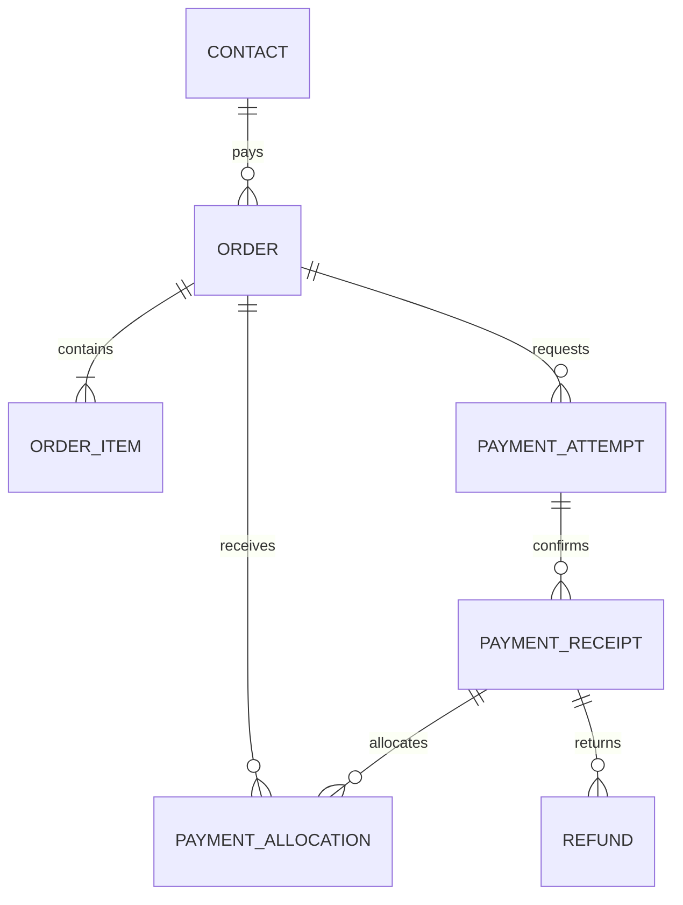

# Единая модель данных учебно-коммерческой платформы

Дата: 2026-11-09. Статус: проект схемы для миграций; не выполненная SQL-миграция.

Связанный документ: [архитектура платформы](PLATFORM_ARCHITECTURE.md). Главная бизнес-БД — PostgreSQL Voronka. MariaDB Chamilo и БД Keycloak имеют собственные схемы; записи в них выполняются через API/поддерживаемые расширения. Единая модель означает один источник бизнес-фактов и устойчивые связи, а не общие физические таблицы всех приложений.

## 1. Общие соглашения

- Идентификаторы новых бизнес-объектов — UUID; существующие UUID-строки Voronka сохраняются до совместимой миграции типов.
- Время — timestamptz UTC; расписание хранит также IANA timezone (например Europe/Moscow).
- Деньги — bigint в минимальных единицах валюты + currency char(3). Округление и распределение скидок детерминированы; никаких float.
- Состояния — явные enum/check-ограничения. У сущностей created_at, updated_at, revision; у неизменяемых событий только occurred_at и последовательность.
- FK существуют внутри PostgreSQL. Внешние ключи Chamilo/IdP — только через таблицы соответствий, без SQL JOIN в чужую БД.
- JSONB — исходные события, дополнительные поля, снимки и ограниченные правила. Он не заменяет нормальные связи сумм, прав и назначений.
- Удаление справочников, связанных с заказами/историей, — архивирование. Финансовые факты неизменяемы; исправления через компенсирующие записи.
- В каждый запрос команды включается проверка доступных проектов/клиентов. Клиентская фильтрация не является авторизацией.
- Схемы ниже — логические группы. Не переносить существующие public-таблицы по схемам без отдельной миграции.
- Уникальности и CHECK не заменяют транзакционные проверки сумм, лимитов и прав.

## 2. Личность, аккаунт и команда

| Таблица | Ключевые поля и связи | Ограничения |
|---|---|---|
| contacts (существует) | id, display_name, primary_email_id?, primary_phone_id?, metadata | Человек существует без логина; stage/score сохраняются временно как legacy-проекции |
| contact_points | id, contact_id, kind(email/phone), raw_value, normalized_value, verified_at?, source | Контактная точка не является автоматическим основанием слияния людей |
| users | id, contact_id, status(invited/active/blocked/closed), locale | Один основной web-аккаунт на contact_id; staff и student — назначения, не отдельные дубли |
| identity_provider_links | id, user_id, issuer, subject, provisioning_status | UNIQUE(issuer, subject), UNIQUE(user_id, issuer); пароль здесь отсутствует |
| identities (существует) | id, contact_id, connection_id, external_user_id, chat_id, display_name | Сохранить UNIQUE(connection_id, external_user_id) |
| identity_bindings | id, user_id, identity_id, verified_at, method, actor_id? | Привязка по одноразовому подтверждению; предотвращать присвоение чужого канала |
| staff_memberships | id, user_id, role(owner/partner/manager), status, approved_by?, approved_at? | Активное членство обязательно для CRM; регистрация с одобрением — этап 2 |
| project_memberships | id, project_id, user_id, role, capabilities | UNIQUE(project_id, user_id); доступ на проект не даёт автоматически все административные права |
| registration_requests | id, user_id, email_verified_at?, approval_status, decided_by?, decided_at? | Только этап 2 для самостоятельной регистрации персонала |
| account_invitations | id, contact_id, kind(student/staff), token_hash, expires_at, consumed_at? | Токен одноразовый; не сохранять plaintext |

Keycloak хранит login/password и recovery credentials в своей служебной БД. Бизнес users.id остаётся устойчивым даже при миграции IdP. Временные коды восстановления не хранятся в contacts. Первоначально ручной список логинов реализуется созданием индивидуальных аккаунтов через административный интерфейс/CLI.

## 3. Проекты, клиенты, сделки и диалоги

| Таблица | Ключевые поля и связи |
|---|---|
| projects (существует) | id, name, goal, status |
| project_contacts | project_id, contact_id, owner_user_id?, source, lifecycle_status |
| tags / contact_tags | id, project_id, name; project_id, contact_id, tag_id |
| pipelines / pipeline_stages | id, project_id, name; id, pipeline_id, code, rank |
| deals | id, project_id, contact_id, offer_id?, stage_id, owner_user_id?, status, next_action_at?, last_interaction_id? |
| deal_stage_events | id, deal_id, old_stage?, new_stage, actor_id?, reason, occurred_at |
| conversations | id, project_id, contact_id, identity_id?, mode(scenario/ai/human/paused), owner_user_id?, revision |
| messages | id, conversation_id, direction, channel, body/resource_id?, external_message_id?, delivery_state, occurred_at |
| interaction_outcomes | id, conversation_id, source_message_id, outcome_code, summary, origin(ai/human/import), reviewed_by?, next_action_id? |
| tasks (расширяется) | id, project_id, contact_id, deal_id?, assigned_to?, title, due_at?, status |
| consent_records | id, contact_id, project_id?, channel, purpose, status, evidence, observed_at |
| communication_preferences | id, contact_id, channel, purpose, state, updated_at |

project_contacts имеет PK(project_id, contact_id); контакт может участвовать в нескольких проектах. Этап сделки не записывается как единственный статус человека. Финансовые состояния не выводятся из фразы в сообщении.

## 4. Каталог, обучение и ресурсы

| Таблица | Ключевые поля и связи | Значение |
|---|---|---|
| products | id, project_id, code, kind(course/seminar/archive/bundle/club), title, state | Коммерческий продукт |
| offers | id, product_id, code, currency, list_price_minor, starts_at?, ends_at?, state | Тариф/предложение; изменения через новую версию |
| offer_versions | id, offer_id, version, price_minor, benefit_snapshot, payment_policy_version_id, access_policy_version_id | Неизменяемый снимок условий |
| courses | id, project_id, code, title, state | Каталожная учебная программа |
| cohorts | id, course_id, title, starts_at?, ends_at?, timezone, state | Поток, независимо от продукта |
| resources | id, project_id, code, kind(module/video/document/archive/live/certificate), title, parent_id?, classification, state | Универсальный объект доступа |
| resource_versions | id, resource_id, version, storage_kind(local/s3/lms/external), locator, content_hash?, metadata | Физическое местоположение/версия, не публичный URL |
| course_resources | course_id, resource_id, position, required | Состав курса |
| offer_benefits | id, offer_version_id, resource_id?/course_id?, capability, valid_for_days?, release_rule | Нормализованные права предложения |
| enrollments | id, user_id, course_id, cohort_id?, state, requested_at, activated_at?, access_revision | Участие и состояние provision |
| enrollment_sources | id, enrollment_id, source_order_item_id?/manual_assignment_id?, state | Независимые основания одного зачисления |
| lms_entity_links | id, local_kind, local_id, instance_id, remote_kind, remote_id, sync_revision, last_synced_at | Сопоставление пользователей/курсов/сессий/материалов Chamilo |
| lms_sync_jobs | id, operation, local_id, desired_revision, status, attempts, next_attempt_at?, error_code? | Очередь синхронизации |
| learning_progress_snapshots | id, enrollment_id, source_revision?, completed, score?, progress?, fetched_at, evidence | Проекция фактов LMS; не альтернативный журнал оценок |

UNIQUE(product.project_id, code), UNIQUE(offer_id, version), UNIQUE(resource_id, version), UNIQUE(instance_id, remote_kind, remote_id), UNIQUE(local_kind, local_id, instance_id). Если LMS-документ используется повторно в разных контекстах, контекст входит в remote_kind/ключ mapping.

Для enrollments с cohort_id NULL использовать явный cohort_key или PostgreSQL NULLS NOT DISTINCT, чтобы UNIQUE(user_id, course_id, cohort_id) действительно исключала дубли. Многократное прохождение при необходимости — отдельная сущность learning_attempts, не случайный дубль.

## 5. Заказы и финансовые факты

| Таблица | Ключевые поля и связи |
|---|---|
| orders | id, project_id, payer_contact_id, currency, state, current_revision, created_by?, placed_at? |
| order_versions | id, order_id, revision, subtotal_minor, discount_minor, total_due_minor, terms_snapshot, created_at |
| order_items | id, order_version_id, product_id, offer_version_id, beneficiary_contact_id, quantity, unit_price_minor, discount_minor, line_due_minor, resource_snapshot |
| payment_plans | id, order_id, version, kind(full/internal_installments/provider_finance), policy_version_id, state |
| installment_obligations | id, payment_plan_id, number, due_at, due_minor, grace_until?, state_projection |
| payment_attempts | id, order_id, installment_id?, provider, merchant_id, provider_invoice_id, requested_minor, currency, mode(test/live), state, expires_at?, checkout_reference |
| provider_events | id, provider, merchant_id, event_key, payload_hash, payload_redacted, verified_at?, processed_at?, state |
| payment_receipts | id, payment_attempt_id, provider_transaction_id, received_minor, currency, confirmed_at, mode |
| payment_allocations | id, payment_receipt_id, order_id, order_item_id?, installment_id?, amount_minor, state |
| refunds | id, payment_receipt_id, provider_refund_id?, amount_minor, status, reason, confirmed_at? |
| allocation_reversals | id, allocation_id, refund_id?, amount_minor, reason, occurred_at |
| order_adjustments | id, order_id, order_item_id?, kind, amount_minor, reason, approved_by, affects_obligation, revision |
| balance_credits | id, order_id, amount_minor, reason, approved_by, occurred_at |
| fiscal_documents | id, order_id, payment_receipt_id?/refund_id?, kind, provider_reference?, state, resource_id?, issued_at? |
| financial_summaries | order_id, revision, due_minor, paid_net_minor, credited_minor, balance_minor, overdue_minor, overpayment_minor, next_due_at?, computed_at |

Здесь payment_receipts — подтверждённые поступления денег; fiscal_documents — кассовые/финансовые документы. Эти понятия не смешиваются.

Инварианты:
1. Плательщик и ученик могут отличаться. Юридическое лицо при необходимости связано с payer_contact через company; при таком сценарии добавить companies и billing_profiles.
2. Валюта allocation совпадает с валютой заказа/поступления; мультивалютные конверсии не подразумеваются.
3. Сумма активных allocations не превышает доступное подтверждённое поступление; контролировать под блокировкой.
4. Сумма подтверждённых refunds не превышает refundable остаток. Сторно allocations связано с refund, а не вычитается второй раз.
5. Сумма действующих обязательств графика совпадает с актуальным обязательством заказа; изменение — новая версия с сохранением истории.
6. После размещения цена заказа неизменяема: новая корректировка фиксируется явно. Пересчёт каталога не переписывает историю.
7. UNIQUE(provider, merchant_id, mode, provider_invoice_id); UNIQUE(provider, merchant_id, event_key); UNIQUE(payment_attempt_id, provider_transaction_id).
8. Если у провайдера нет отдельного event_id, event_key выводится из подтверждённых устойчивых идентификаторов операции/типа, а не из произвольного текста webhook.
9. test/live никогда не смешиваются; тестовый платёж не выдаёт рабочий платный доступ.
10. financial_summaries — пересчитываемая проекция, не источник денег. Сертификат использует актуальную ревизию фактов.
11. Рассрочка банка и график платежей продавцу имеют разную семантику. Полное подтверждённое поступление продавцу может закрыть заказ.
12. Скидка входит в total_due; не вычитать её второй раз как balance_credit.

Названия диаграммы — сокращённые логические сущности; реальные таблицы перечислены выше.

## 6. Промокоды

| Таблица | Поля |
|---|---|
| discount_rules | id, project_id, kind(percent/fixed), value, currency?, scope, stack_policy, min_order_minor?, starts_at?, ends_at?, state |
| promo_codes | id, rule_id, code_normalized, max_redemptions?, per_contact_limit?, campaign_id?, owner_user_id?, state |
| promo_reservations | id, promo_code_id, order_id, contact_id, expires_at, state(reserved/consumed/expired/released) |
| promo_redemptions | id, promo_code_id, order_id, contact_id, reservation_id?, applied_minor, redeemed_at, reversal_state |
| order_discounts | id, order_version_id, order_item_id?, rule_version_snapshot, promo_code_id?, amount_minor |

UNIQUE(project_id, normalized_code) реализовать через project_id в promo_codes или контролируемую составную связь; уникальность не должна зависеть от JOIN. Уникальное потребление промокода на заказ. Общий и персональный лимиты проверяются внутри транзакции с блокировкой счётчика/кода; одних предварительных запросов недостаточно.

Стоимость и распределение скидок сохраняются в заказе. Партнёр не может превысить назначенный ему лимит скидки.

## 7. Права, ограничения и исключения

| Таблица | Поля |
|---|---|
| access_policies | id, project_id, code, current_version_id |
| access_policy_versions | id, policy_id, version, conditions, capabilities, state, created_by |
| entitlement_grants | id, user_id, resource_id?/resource_set_id?, capability, source_kind, source_id, policy_version_id, starts_at?, expires_at?, state, revision |
| entitlement_denials | id, user_id, scope_kind, scope_id, capability, reason, starts_at?, expires_at?, actor_id |
| resource_sets / resource_set_items | id, project_id, code; resource_set_id, resource_id |
| permission_exceptions | id, user_id, resource_id, capability, reason, approved_by, starts_at, expires_at, state |
| access_decisions_audit | id, user_id, action, resource_id, allow, reason_codes, grant_ids, policy_revision, financial_revision?, evaluated_at, correlation_id |
| materialized_access | user_id, resource_id, capability, allow, policy_revision, evaluated_at, valid_until |

Ресурс или набор задаётся ровно одним способом (CHECK). source_kind + source_id — типизированное основание, поддержанное прикладной проверкой; если нужна строгая FK-целостность для основания, использовать отдельные FK-колонки и CHECK ровно одного значения. Не оставлять неограниченную «магическую строку».

materialized_access и LMS-назначения — проекции. При выдаче сертификата/входе в платную комнату проверка актуальных фактов обязательна. Обычный кэш allow не старше 30 секунд. Выдача скачиваемого файла не обещает его удаление с устройства.

У активного права могут быть несколько оснований. Удаление/возврат одного источника не удаляет остальные. Явный deny имеет приоритет; исключение сертификата требует отдельного типа исключения и аудита.

Старые entitlements(contact_id, product_key) мигрируются как legacy_grant после сопоставления продукта/ресурса; не становятся фиктивными платежами. До активации user права могут оставаться pending_claim для contact и подтверждённо назначаться при привязке.

## 8. Занятия, документы, архив и сертификаты

| Таблица | Поля и смысл |
|---|---|
| live_sessions | id, project_id, cohort_id?, resource_id, title, starts_at, ends_at, timezone, provider, room_reference_encrypted?, state, revision |
| live_session_registrations | id, live_session_id, user_id, enrollment_id?, state, attended_at? |
| live_access_issues | id, live_session_id, user_id, token_hash?/provider_ref, expires_at, state |
| document_assignments | id, resource_id, user_id/contact_id, purpose, delivery_mode, starts_at?, expires_at?, state |
| document_acceptances | id, document_assignment_id, resource_version_id, actor_user_id, accepted_at, evidence |
| archive_collections | id, project_id, title, state |
| archive_items | archive_collection_id, resource_id, source_course_id?, source_live_session_id?, position |
| certificate_types | id, project_id, template_resource_id, requirements_version, issuer |
| certificate_requests | id, enrollment_id, certificate_type_id, state, academic_snapshot, financial_revision, policy_version, checked_at |
| certificates | id, request_id, enrollment_id, certificate_type_id, serial, resource_version_id, verification_token_hash, issued_at, revoked_at?, revocation_reason? |

UNIQUE(live_session_id, user_id) для регистрации; UNIQUE(serial); один действующий сертификат данного типа на enrollment через частичный unique index. Перевыпуск хранит ссылку replaces_certificate_id и историю.

Финансовые сведения ученика не включаются в публичный QR/проверку сертификата. В архиве курса может быть несколько материалов с разными сроками доступа. Сам факт попадания в archive_items права не выдаёт.

Для document_assignments ровно один адресат user/contact либо явный общий ресурс; персональные документы не наследуют публичность учебного материала. Доступ к «данным» оформляется тем же resource/capability, но реальные строки/наборы фильтруются сервером — ссылка на отчёт не открывает всю БД.

## 9. Импорт, коммуникации и надёжность

| Таблица | Назначение |
|---|---|
| import_templates | Сопоставление колонок, кодировка/разделитель, правила нормализации |
| import_batches | Файл/resource, project_id, hash, шаблон, статус, автор и счётчики |
| import_rows | batch_id + row_number, исходные/нормализованные данные, результат и target IDs |
| merge_requests / merge_events | Предложение и подтверждённое слияние, прежние ID и происхождение |
| campaigns | Проект, сегмент, шаблон, тип, канал, статус, автор запуска |
| campaign_recipients | campaign_id + contact_id + connection_id, результат допуска, статус отправки |
| scheduled_actions | contact/user, source_kind + source_id + revision, action_type, due_at, state |
| runs / versions / funnels / entries | Существующие сценарии и атрибуция сохраняются |
| inbox / outbox / events | Существующая доставка; нужна совместимая миграция и общее correlation_id |
| domain_outbox | Доменные события финансов/прав/обучения, aggregate_id/version, payload, published_at? |
| integration_inbox | Дедупликация событий LMS/IdP/провайдеров |
| integration_jobs | Тип, ключ идемпотентности, желаемая revision, попытки, lease, next_attempt_at |
| audit_events | Административные действия, экспорт, изменение прав, причины исключений |
| ai_jobs / ai_interactions | Входное сообщение, project/user scope, статус, источники ответа, модель, стоимость, действие |
| external_services | Ссылки на настройки провайдеров; имена секретов в окружении, а не plaintext ключи |

Уникальные ключи:
- import_rows(batch_id, row_number); повторное выполнение строки не создаёт новый контакт;
- campaigns: один получатель на campaign/contact/connection; повтор задачи использует ту же запись;
- scheduled_actions(source_kind, source_id, source_revision, action_type, recipient, channel);
- integration_jobs(idempotency_key), integration_inbox(source, event_key);
- существующий inbox(connection_id, external_event_id) сохраняется.

Изменившийся source_revision отменяет устаревшее pending-напоминание. После получения оплаты не отправляется старое напоминание о долге. Состояние sent относится к ответу платформы, а не к прочтению.

## 10. Индексы и серверные ограничения

- deals(project_id, owner_user_id, stage_id, updated_at DESC);
- project_contacts(project_id, contact_id), identities(contact_id);
- messages(conversation_id, occurred_at DESC, id);
- orders(project_id, payer_contact_id, placed_at DESC);
- installment_obligations(due_at) для действующего графика;
- entitlement_grants(user_id, state, resource_id, capability);
- enrollments(user_id, state), lms_sync_jobs(status, next_attempt_at);
- inbox/outbox/integration_jobs частичные индексы по pending и due_at/available_at;
- contact_points(kind, normalized_value), не обязательно UNIQUE между разными людьми;
- audit_events(project_id, occurred_at), import_rows(batch_id, status);
- event-временные таблицы при росте разбиваются по периодам, не раньше измеренного запроса.

Глобальные блокировки и бизнес-проверки не заменяются необязательным Redis-кэшем. У каждого сервиса отдельные DB credentials; Next.js не подключается к MariaDB.

## 11. Контракты чтения для Next.js

Это проект API Voronka, не существующие endpoints Chamilo:

- GET /api/account/overview — активные курсы, ближайшие занятия, документы, финансовые предупреждения.
- GET /api/account/courses — карточки и состояние синхронизации LMS.
- GET /api/account/orders/{id} — цена, скидка, оплачено, остаток, график и документы; только собственные разрешённые данные.
- POST /api/account/resources/{id}/access — решение и ограниченная ссылка/переход.
- POST /api/account/live-sessions/{id}/join — проверка и вход.
- POST /api/account/enrollments/{id}/certificates/request — заявка, не безусловная выдача.
- POST /api/checkout/quote — серверная цена и допустимый промокод.
- POST /api/orders — создание с ключом идемпотентности.
- POST /api/orders/{id}/payment-attempts — счёт провайдера, проверка суммы/режима на сервере.
- CRM endpoints для импорта, экспорта, прав и скидок требуют отдельного staff-допуска.

Для выдачи права возвращать allow/deny, reason_codes, expires_at, policy_revision. Причина в интерфейсе может быть человекочитаемой: «Осталось оплатить 5 000 ₽», но персональные финансовые детали не раскрываются постороннему пользователю по чужому resource/order ID.

## 12. Разделение базы и проекций

В Chamilo остаются её штатные таблицы учеников, курсов, сессий, учебных результатов и файлов. В IdP — credentials и технические сессии. В RAGA — знания, retrieval и её внутренние сущности.

Ключи связи:
- contacts.id → users.contact_id;
- users.id ↔ identity_provider_links(issuer, subject);
- users/courses/cohorts/resources/enrollments ↔ lms_entity_links;
- order_items → enrollment_sources и entitlement_grants;
- enrolment → progress snapshots и certificate request;
- resource → resource_versions → конкретное хранилище.

Единая карточка клиента строится по этим связям из главной БД и проверяемых проекций. Она не выполняет произвольные прямые запросы к чужим базам во время открытия страницы.
